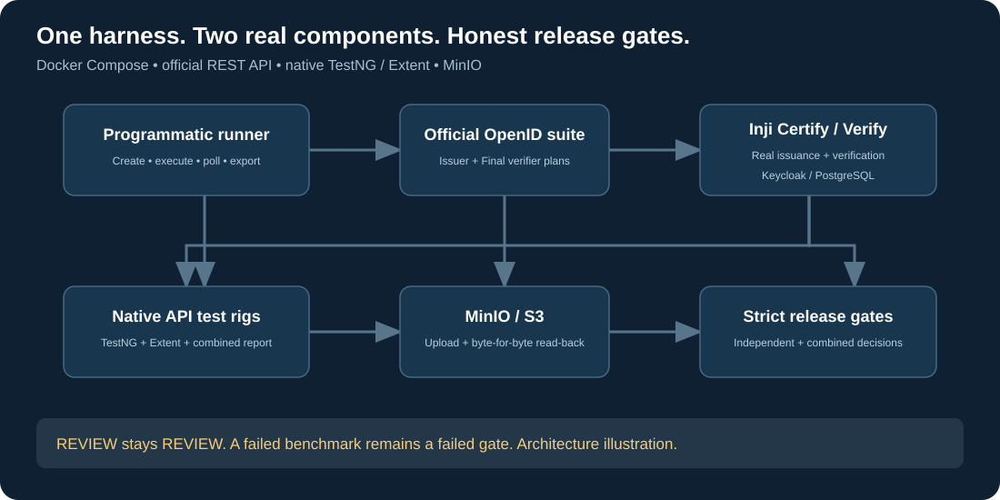
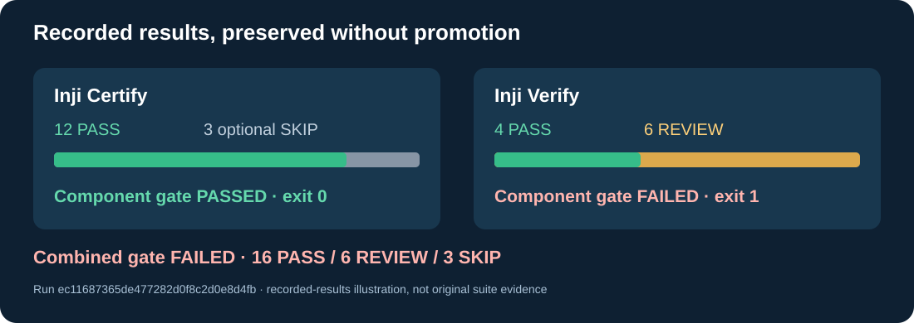
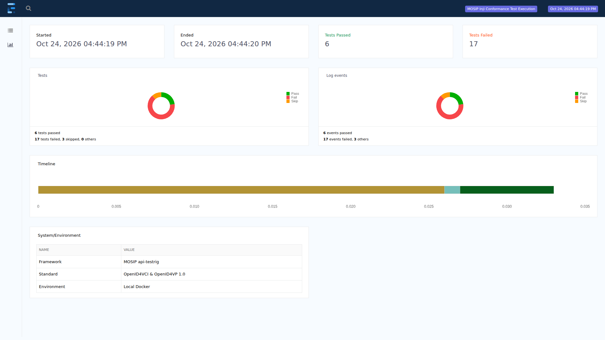
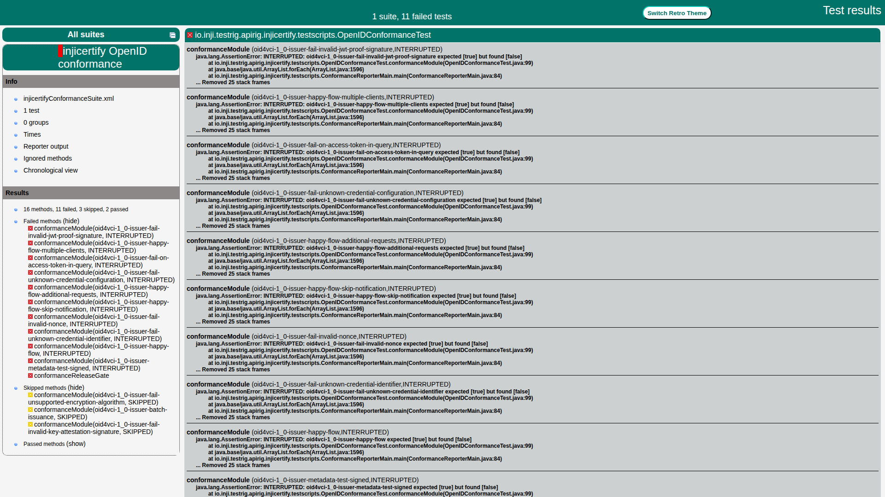
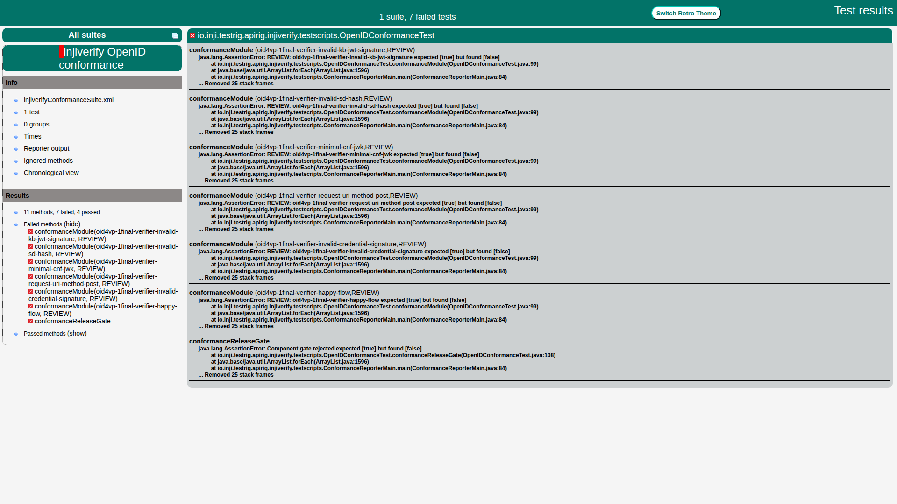
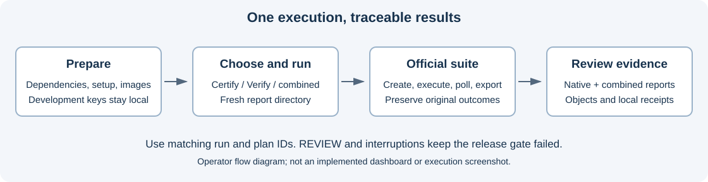

# Automated Conformance Testing for Inji Certify and Inji Verify

Run the OpenID Foundation conformance suite against real Inji services, feed official outcomes into both existing API test rigs, and produce consolidated reports with strict release gates.



## Quick start

Prerequisites: Linux or Ubuntu/WSL with Docker Compose, Python 3.12 and the
installed Python requirements. Full reporting also needs Java 21, Maven 3.8.7,
the installed native API rigs and Chromium. The standalone bridge targets Java 11.
Follow [environment preparation](#prepare-the-environment-and-images) for image
builds and browser installation before starting the services.

Clone the private submission repository with an account that has accepted its
invitation, then work from its root directory:

```bash
git clone https://github.com/SantoshReddy0603/WakeupNeo-mosip-inji-conformance.git
cd WakeupNeo-mosip-inji-conformance
```

Run setup **before the tests or deployment**. It generates development keys and
the TLS certificate required by the Compose mount checks. Generated files are
local configuration and must not be committed.

```bash
python -m pip install -r runner/requirements-dev.txt
python runner/setup.py
```

Choose one live execution mode after environment preparation:

```bash
bash run-conformance.sh --component certify --insecure
bash run-conformance.sh --component verify --insecure
bash run-conformance.sh --combined --parallel 2 --insecure
```

Run the Python harness tests after setup:

```bash
python -m pytest tests -q
```

The stock release conformance gates correctly fail when the recorded product
outcomes recur: Certify 2 PASSED / 10 INTERRUPTED / 3 SKIPPED and Verify
4 PASSED / 6 REVIEW. The patched build is diagnostic only. Hosted full-stack
validation ran in the scratch repository at commit
`9c8d94ad9da42ac458ea304192118266577469f9`, run `40165722639`.
The selected official verifier plan and strict REVIEW handling remain unchanged.

## Test data

[docs/TEST_DATA.md](docs/TEST_DATA.md) lists the synthetic course record,
credential configuration, development clients, endpoints and selected plan variants.
Secrets are generated locally by `runner/setup.py`; no real personal data is needed.

## What the project provides

- Docker Compose orchestration for the official suite, Inji Certify, Inji Verify, Keycloak, PostgreSQL, MongoDB and MinIO.
- Official REST API automation to configure plans, execute modules, poll outcomes and retrieve exports.
- `OpenIDConformanceTest` integration in both existing api-testrigs, with TestNG and Extent reporting.
- Certify-only, Verify-only and combined execution; independent component gates and consolidated results.
- Real PostgreSQL-backed synthetic course issuance and genuine browser evidence capture; native patches are isolated to the diagnostic build.
- Artifact upload and byte-for-byte read-back, regression comparison, selective plans and parallel component execution.
- Hosted CI plus an actual release-triggered full-stack workflow, with artifacts retained on benchmark failure.

## Recorded stock and patched results

Recorded stock reference run: `019bf015dcef47029010faa06a2cf788`. This used the unmodified `injistack/inji-certify-with-plugins:1.0.0-alpha.1` image and the unified stack.

| Evidence | Stock release gate (default) | Diagnostic, patched build |
|---|---|---|
| Official run ID | `019bf015dcef47029010faa06a2cf788` | `d39d9f65b0f04db79eb3d25501c9f26c` |
| Issuer export | `plan-UYoPyoeGriNRN-export.zip` | `plan-yfOPDtRoNo2xZ-export.zip` |
| Certify image | `injistack/inji-certify-with-plugins:1.0.0-alpha.1` | `inji-harness/certify-positive:local` |
| Certify image ID | `sha256:1579b2449f1a7213fe25de1f6a1509b5636f1fedf0d7f5c4cfd07b9f0fc5b346` | `sha256:5aa0ba5750b177b10348344708ae86b64a173ea3657b75272dab7014b943a2a6` |
| Certify | 2 PASS, 10 INTERRUPTED, 3 optional SKIP; FAILED | 12 PASS, 3 optional SKIP; PASSED |
| Verify | 4 PASS, 6 REVIEW; FAILED | 4 PASS, 6 REVIEW; FAILED |
| Combined | 6 PASS, 10 INTERRUPTED, 6 REVIEW, 3 SKIP; FAILED | 16 PASS, 6 REVIEW, 3 SKIP; FAILED |

Stock reporting returned Certify 1, Verify 1 and combined 1. The lifecycle verified 114 stored artifacts, an
independent read-back checked 71 core objects, and cleanup removed the five owned volumes. Official
signed-metadata and issuance/error-response checks interrupted on the unmodified image. Exact conditions and
original logs remain with the private run evidence.

The 25 October local verifier reproduction, run `0d9b58120a964f628a34dd0c658d6c8f`, again returned 4 PASSED
and 6 REVIEW with a failed gate (`plan-IpxODLyKkxZNN-export.zip`); [validation limits](docs/VALIDATION.md)
identify the actual POST-named and happy-flow instances and their missing coverage.

The patched diagnostic uses the audited native fixes described in [docker/RELEASES.md](docker/RELEASES.md). Its issuer PASS does not qualify the stock release. The following illustration summarizes recorded patched results only:



The standalone bridge compiled from fresh source and passed its seven TestNG mapping scenarios on actual JDK
11. The pinned native API-test modules require Java 21 and failed JDK 11 compilation with `error: invalid
target release: 21`; exact upstream POM lines and compiler logs are cited in [validation
limits](docs/VALIDATION.md). Their actual Java 21 integration/reporting is separate. Harness, syntax and
workflow checks are listed in [the requirement checklist](REQUIREMENTS_STATUS.md).

**REVIEW remains REVIEW.** The harness maps it to a failed TestNG assertion and rejects the release gate. It
does not manufacture PASS results. TestNG includes an extra gate assertion, so its counts differ from the
official module counts. These results establish working automation, not complete OpenID conformance or
certification. The diagrams summarize recorded results; official outputs remain authoritative. This
source-only package omits raw execution artifacts. A new installation or changed source needs its own
validation.

### Stock interruption triage

The ten stock interruptions are PRODUCT_GAP findings from issuer export `plan-UYoPyoeGriNRN-export.zip` (run
`019bf015dcef47029010faa06a2cf788`); matched diagnostic results are from `plan-yfOPDtRoNo2xZ-export.zip` (run
`d39d9f65b0f04db79eb3d25501c9f26c`). No harness correction was justified; exact messages, last successful
steps, requests/responses and matched patched instance IDs are in [the triage](docs/STOCK_CERTIFY_TRIAGE.md).
Names share prefix `oid4vci-1_0-issuer-`; patch paths share `docker/native-certify/`; isolated patch
attribution is not verified.

| Test name | Status | Class | Evidence | Patch that fixes it | Action taken |
|---|---|---|---|---|---|
| `metadata-test-signed` | Stock INTERRUPTED / diagnostic PASSED | PRODUCT_GAP | 200 OK, empty body | `signed-metadata.patch` | Retain stock failure |
| `happy-flow` | Stock INTERRUPTED / diagnostic PASSED | PRODUCT_GAP | 500 INTERNAL_SERVER_ERROR, unknown_error: unrecognized extension field | `extensions.patch`, `dpop.patch`, `holder-binding.patch` | Retain stock failure |
| `happy-flow-additional-requests` | Stock INTERRUPTED / diagnostic PASSED | PRODUCT_GAP | 401 UNAUTHORIZED, {"error":"invalid_token","error_description":"invalid_token"} | `dpop.patch`, `extensions.patch`, `holder-binding.patch` | Retain stock failure |
| `happy-flow-multiple-clients` | Stock INTERRUPTED / diagnostic PASSED | PRODUCT_GAP | 401 UNAUTHORIZED, {"error":"invalid_token","error_description":"invalid_token"} | `dpop.patch`, `extensions.patch`, `holder-binding.patch` | Retain stock failure |
| `happy-flow-skip-notification` | Stock INTERRUPTED / diagnostic PASSED | PRODUCT_GAP | 401 UNAUTHORIZED, {"error":"invalid_token","error_description":"invalid_token"} | `dpop.patch`, `extensions.patch`, `holder-binding.patch` | Retain stock failure |
| `fail-invalid-nonce` | Stock INTERRUPTED / diagnostic PASSED | PRODUCT_GAP | 401 UNAUTHORIZED, {"error":"invalid_token","error_description":"invalid_token"} | `dpop.patch` | Retain stock failure |
| `fail-invalid-jwt-proof-signature` | Stock INTERRUPTED / diagnostic PASSED | PRODUCT_GAP | 401 UNAUTHORIZED, {"error":"invalid_token","error_description":"invalid_token"} | `dpop.patch` | Retain stock failure |
| `fail-unknown-credential-configuration` | Stock INTERRUPTED / diagnostic PASSED | PRODUCT_GAP | 401 UNAUTHORIZED, {"error":"invalid_token","error_description":"invalid_token"} | `dpop.patch`, `credential-errors.patch` | Retain stock failure |
| `fail-unknown-credential-identifier` | Stock INTERRUPTED / diagnostic PASSED | PRODUCT_GAP | 500 INTERNAL_SERVER_ERROR, unknown_error: unrecognized credential_identifier | `credential-errors.patch` | Retain stock failure |
| `fail-on-access-token-in-query` | Stock INTERRUPTED / diagnostic PASSED | PRODUCT_GAP | 401 UNAUTHORIZED, {"error":"invalid_token","error_description":"invalid_token"} | `dpop.patch`, `extensions.patch`, `holder-binding.patch` | Retain stock failure |

The live variant cross-check found `dpop` and `mtls`, with no unconstrained Bearer option. Seven stock
mTLS-labelled cases produced 2 PASSED, 4 FAILED and 1 INTERRUPTED (official plan `45vEXNrkMzWtm`,
`plan-45vEXNrkMzWtm-export.zip`); token responses were unbound Bearer, so end-to-end mTLS binding is **not
verified**. The three entry-point defaults remain unchanged; [the triage](docs/STOCK_CERTIFY_TRIAGE.md)
records all before/after outcomes and the decision.

## Recorded report screenshots

These are browser captures of unmodified retained reports from stock run
`019bf015dcef47029010faa06a2cf788`, not a new execution. The combined TestNG
view includes one gate assertion: 6 passed, 17 failed and 3 skipped checks.
Original official outcomes remain 6 PASSED, 10 INTERRUPTED, 6 REVIEW and 3 SKIPPED.



<details>
<summary>Per-module TestNG reports</summary>

Certify: 2 passed, 11 failed and 3 skipped checks, including its gate assertion.



Verify: 4 passed and 7 failed checks, including six REVIEW assertions and its gate assertion.



</details>

[Capture sources and hashes](docs/SCREENSHOTS.md) identify the retained report pages.
These report screenshots do not establish new service execution or product conformance.

## Requirements

The validated environment is Windows with Ubuntu/WSL, Docker Desktop Linux containers and Ubuntu integration,
Python 3.12, Java 21 and Maven 3.8.7. Use at least 6 GiB of Linux memory; the tested environment had about 7.6
GiB. Keep ports `8443`, `8445`, `8446`, `9000` and `9001` available.

Internet access is required for upstream source, images, Maven dependencies and the matching Playwright
browser. No external issuer account, real personal records or GitHub token is needed for local synthetic
issuance. The managed stack and networking were verified on GitHub-hosted ubuntu-24.04 in private scratch run `40165722639` at
`9c8d94ad9da42ac458ea304192118266577469f9`; this does not establish arbitrary Linux distributions or the
separate empty-cache procedure.

## Prepare the environment and images

Run inside Ubuntu/WSL from this repository. Keep the virtual environment outside the source tree:

```bash
umask 022
python3 -m venv ~/inji-conformance-venv
source ~/inji-conformance-venv/bin/activate
python -m pip install -r runner/requirements-dev.txt
python -m playwright install --with-deps chromium
export PYTHON="$(command -v python)"
export CONFORMANCE_RESOLVE_LOCAL=true
docker info
docker compose version
```

Prepare the stock deployment images once. These commands generate development configuration in this checkout; use a separate clean extraction for execution:

```bash
python runner/setup.py
docker compose --env-file docker/.env -f docker/docker-compose.yml build conformance-server
docker compose --env-file docker/.env -f docker/docker-compose.yml --profile storage build minio

while IFS= read -r image; do
  if ! docker image inspect "$image" >/dev/null 2>&1; then
    docker pull "$image" || exit
  fi
done < <(docker compose --env-file docker/.env -f docker/docker-compose.yml --profile certify --profile verify --profile storage config --images | sort -u)
```

For a separate patched diagnostic, build its image with `python runner/build_native_certify.py --positive-serial`. It is a local build of pinned source, not an unmodified upstream release. See [native release details](docker/RELEASES.md).

## Run both components with fresh data

After committing or checking out the desired source revision, create a new source-only extraction for each run. Do not copy `.env`, generated keys or old reports into it:

```bash
SOURCE_ROOT="$PWD"
STAMP="$(date +%Y%m%d-%H%M%S)"
RUN_DIR="$HOME/inji-conformance/run-$STAMP"
REPORT_DIR="$HOME/inji-conformance/reports-$STAMP"
mkdir -p "$RUN_DIR"
git -C "$SOURCE_ROOT" archive HEAD | tar -x -C "$RUN_DIR"
cd "$RUN_DIR"

bash run-clean-conformance.sh --combined --parallel 2 --reports-dir "$REPORT_DIR"
RUN_EXIT=$?
echo "Execution exit code: $RUN_EXIT"
cat "$REPORT_DIR/reporter-exit-statuses.json"
```

The unified stack starts ten real services with fresh keys and five owned volumes, runs the normal reporting
lifecycle, and cleans up only its owned deployment on exit. It expects the images prepared above. Stock
execution exits **1** when its recorded interruptions and REVIEWs recur. Explicit patched diagnostics also
exit **1** while REVIEW remains. Inspect reports to distinguish that benchmark failure from startup, browser,
reporting or storage errors. Each run needs a fresh extraction.

### Component and persistent development modes

The ordinary wrapper defaults to the unmodified release:

```bash
bash run-conformance.sh --component certify --insecure
bash run-conformance.sh --component verify --insecure
bash run-conformance.sh --combined --parallel 2 --insecure
```

Choose one command at a time. Add `--native-positive` only for a separately labelled patched diagnostic. Use
distinct `--reports-dir` paths to preserve runs. `--skip-docker` targets an already configured deployment and
requires its actual environment settings. `--insecure` is explicitly for local self-signed TLS; use a trusted
CA for other environments. PowerShell equivalents are available in `run-conformance.ps1`. See
[SETUP.md](SETUP.md) before reusing existing database volumes or credentials.

## Run both components and inspect reports

Use this persistent workflow to run both components and keep the official suite
and MinIO available while inspecting the results. Complete
[environment preparation](#prepare-the-environment-and-images) first.
The clean-run workflow above removes its owned deployment at completion.

### 1. Prepare the terminal

Run in Ubuntu/WSL Bash. Adjust the checkout path if needed. Activating the
prepared virtual environment selects the installed Python dependencies; the
exports select that interpreter and enable local hostname resolution.

```bash
cd ~/WakeupNeo-mosip-inji-conformance
source ~/inji-conformance-venv/bin/activate
export PYTHON="$(command -v python)"
export CONFORMANCE_RESOLVE_LOCAL=true
python runner/setup.py
```

### 2. Start and check services

Start the prepared Certify, Verify and storage profiles without rebuilding images,
then check all containers.
Confirm all ten services are running; investigate exited or restarting services
before proceeding. The execution wrapper also waits for service readiness.

```bash
docker compose --env-file docker/.env \
  -f docker/docker-compose.yml \
  --profile certify --profile verify --profile storage up -d --no-build

docker compose --env-file docker/.env \
  -f docker/docker-compose.yml \
  --profile certify --profile verify --profile storage ps -a
```

### 3. Execute with a separate report folder and log

A unique directory preserves each execution's reports. The combined wrapper
creates and runs both official plans, generates native and consolidated reports,
and uploads artifacts to MinIO. A fresh report directory does not reset existing
database volumes.

Copy the complete block so the conformance exit status is captured immediately
after the pipeline. The saved `PIPESTATUS` array retains both the runner's status
and the log writer's status when output is piped through `tee`. `--insecure` is for local self-signed TLS.

```bash
export REPORT_DIR="$(mktemp -d "$HOME/inji-reports-XXXXXXXX")"
export RUN_LOG="${REPORT_DIR}.log"
printf 'Report folder: %s\n' "$REPORT_DIR"

set +e
bash run-full-stack-conformance.sh \
  --insecure --parallel 2 --reports-dir "$REPORT_DIR" \
  2>&1 | tee "$RUN_LOG"
RUN_STATUSES=("${PIPESTATUS[@]}")
RUN_EXIT=${RUN_STATUSES[0]}
LOG_EXIT=${RUN_STATUSES[1]}
printf 'Actual conformance exit: %s\n' "$RUN_EXIT"
printf 'Log write exit: %s\n' "$LOG_EXIT"
printf 'Console log: %s\n' "$RUN_LOG"
```

A nonzero exit can indicate a rejected release gate or an operational failure.
The recorded stock results produce exit 1 because the gate rejects the build.
Do not assume that every exit 1 has that cause. The log writer should return 0.
Inspect current reports and reporter/storage statuses before interpreting it.
Missing reports, startup errors and storage failures require investigation.

### 4. Identify the run and its reports

Use the current summary to obtain the run ID, official plan IDs and complete
browser report URLs. Keep using this terminal so `REPORT_DIR` remains available.

```bash
python - <<'PY'
import json
import os
from pathlib import Path

folder = Path(os.environ["REPORT_DIR"])
summary = folder / "conformance-summary.json"
if not summary.is_file():
    raise SystemExit("No summary was produced. Inspect the console log before continuing.")
report = json.loads(summary.read_text())
run_id = report["run_id"]
required = [folder / "extent-report.html", folder / "reporter-exit-statuses.json"]
plans = {}
for component in ("certify", "verify"):
    plan_id = report.get("runs", {}).get(component, {}).get("summary", {}).get("plan_id")
    if not plan_id:
        raise SystemExit(f"No {component} plan ID. Inspect startup and runner errors.")
    plans[component] = plan_id
    required.append(folder / f"existing-{component}" / run_id / "index.html")
missing = [str(path) for path in required if not path.is_file()]
if missing:
    raise SystemExit("Missing current reports: " + ", ".join(missing))

print("\nRUN ID:", run_id)
print("REPORT FOLDER:", folder)
for component, plan_id in plans.items():
    print(component.upper(), "PLAN ID:", plan_id)

print("\nREPORT LINKS:")
print("http://localhost:8765/extent-report.html")
print(f"http://localhost:8765/existing-certify/{run_id}/index.html")
print(f"http://localhost:8765/existing-verify/{run_id}/index.html")
PY

cat "$REPORT_DIR/reporter-exit-statuses.json"
```

If the summary, reporter-status file or HTML reports are missing, investigate
before continuing. Use the new run's IDs and results.

### 5. Serve and open the HTML reports

Serve the report directory on loopback to open the native and combined reports
in a browser. Port `8765` must be available. Stop any previous report server in
its terminal with Ctrl+C before starting another.

```bash
python -m http.server 8765 --bind 127.0.0.1 \
  --directory "$REPORT_DIR"
```

Leave this terminal running and open the URLs printed in step 4.

| Report | Purpose |
|---|---|
| Certify native report | Inspect issuer outcomes in the existing Certify API test rig |
| Verify native report | Inspect verifier outcomes and unresolved REVIEW results |
| Combined `extent-report.html` | Inspect consolidated outcomes and release gates |

Official interruptions and REVIEW results remain visible. TestNG maps them to
failed assertions and adds a gate assertion, so its method counts can differ
from the official module counts. Interpret the current run rather than assuming
historical counts.

### 6. Inspect official plans and stored artifacts

Open the local interfaces while Docker services remain running:

| Interface | What to inspect |
|---|---|
| [Official suite](https://localhost:8443) | Select **Test Plans** and find both plan IDs printed in step 4 |
| [MinIO console](http://localhost:9001) | Open `automationtests` → `openid-conformance` → the run ID printed in step 4 |

For local development, accept the generated certificate warning if prompted.
Sign into MinIO with the generated local credentials in `docker/.env`:
`AWS_ACCESS_KEY_ID` is the username and `AWS_SECRET_ACCESS_KEY` is the password.
Read those two values privately before recording; do not display the file, keys
or raw credentials. The credentials are preserved across runs unless explicitly
changed; each execution gets a new run ID and artifact prefix. If `S3_BUCKET` was
overridden, open that configured bucket instead of `automationtests`.

The local `artifact-storage-validation.json` records the upload and read-back.
It is not an object to look for in the MinIO console. To perform another read-only
integrity check, stop the report server with Ctrl+C and run this in the same
terminal, where `REPORT_DIR` and the virtual environment are still available:

```bash
python runner/verify_storage.py "$REPORT_DIR" --env-file docker/.env \
  --output "$REPORT_DIR/storage-readback.json"
```

This reads the current run's actual stored objects and writes a local receipt.
No new official conformance test is started. Keep private keys and raw credential
contents private.

### 7. Inspect expected-failure configuration

In another terminal, activate the prepared environment and inspect the
configured exemptions. You can also reuse the first terminal after stopping
the report server:

```bash
cd ~/WakeupNeo-mosip-inji-conformance
source ~/inji-conformance-venv/bin/activate
cat config/expected-failures.json
```

The submitted default is empty, so it applies no exemptions. Check the actual
file if using a modified configuration.

### 8. Inspect implementation CI and optional regression checks

Open the repository's [Actions page](https://github.com/SantoshReddy0603/WakeupNeo-mosip-inji-conformance/actions)
and choose the run for the revision being shown. Recorded implementation CI
[41447614435](https://github.com/SantoshReddy0603/WakeupNeo-mosip-inji-conformance/actions/runs/41447614435)
passed all five jobs at `f28d53004b20b5f88c911668152634f3389a10d9`.
It is a separate execution from the local conformance run. Green implementation
CI does not override stock interruptions, REVIEW outcomes or failed release gates.

These optional commands inspect workflow definitions and run labelled harness
contract tests for exception/diff handling; the tests are not official evidence:

```bash
cat .github/workflows/ci.yml
cat .github/workflows/full-stack-conformance.yml
python -m pytest tests/test_optional_features.py -q -k 'exception_file or expected_failure or diff_records'
```

No GitHub workflow is dispatched by these commands.

### 9. Stop the report server and services

Press Ctrl+C in the report-server terminal when finished. This stops only the
HTTP server. To stop the persistent deployment without deleting its volumes,
run from the same checkout:

```bash
docker compose --env-file docker/.env \
  -f docker/docker-compose.yml \
  --profile certify --profile verify --profile storage stop
```

## Evidence access

Hosted full-stack evidence comes from private scratch run `40165722639` at
`9c8d94ad9da42ac458ea304192118266577469f9`. The scratch repository is not a
reviewer-accessible evidence link. See [the evidence index](evidence/README.md).
The Google Drive evidence handoff is deferred; upload and reviewer access are
**not verified**. No Drive destination is claimed until one is supplied.

## Reports and interfaces

For the complete manual run and report-viewing sequence, see
[Run both components and inspect reports](#run-both-components-and-inspect-reports).

| Artifact | Purpose |
|---|---|
| `conformance-summary.json` | Official module outcomes and component/combined gates |
| `extent-report.html`, `testng-results.xml` | Consolidated visual and machine-readable reports |
| `existing-certify/`, `existing-verify/` | Actual native module reports |
| `reporter-exit-statuses.json` | Native and consolidated reporter exit codes |
| `plan-*-export.zip` | Official plan exports |
| `artifact-storage-validation.json` | Verified storage object hashes and keys |

On Windows/WSL, open reports with `explorer.exe "$(wslpath -w "$REPORT_DIR")"`. While the services are
running, the suite is at `https://localhost:8443`, Verify UI at `https://localhost:8445/verify`, and MinIO
console at `http://localhost:9001`. The clean wrapper tears them down at completion. Raw exports, credentials,
keys and runtime evidence stay outside committed source.

## CI and validation

The recorded runtime candidate passed [ordinary CI
40165694278](https://github.com/SantoshReddy0603/mosip-inji-conformance/actions/runs/40165694278). Its
private scratch run `40165722639`
verified all five hosted implementation criteria at `9c8d94ad9da42ac458ea304192118266577469f9`: ten services
started; both official plans executed; native/consolidated reports and two GitHub artifacts were retained; 114
storage objects were verified; and five owned volumes were removed with none remaining. Official run
`2583bed425d64f5abb0c86993d402116` reproduced stock Certify 2 PASSED / 10 INTERRUPTED / 3 SKIPPED and Verify 4
PASSED / 6 REVIEW. The gate job is FAILED because those actual results reject the strict benchmark; Hosted
implementation success is not stock conformance or certification. See [validation evidence and
limits](docs/VALIDATION.md#hosted-validation--25-october-2026).

- Recorded hosted implementation checks passed all five jobs on their tested revision. Inspect the repository Actions tab for the exact revision you intend to run.
- A recorded release-triggered full-stack run completed reporting, storage, artifact upload and cleanup; six REVIEW outcomes failed the strict gate. Historical evidence is retained separately.

Pull requests run harness checks, both API test-rig integrations and native product tests. Privileged live
release/manual jobs require an approved environment and either the default disposable ubuntu-24.04 managed
deployment or a reachable external deployment; a dedicated self-hosted runner is an explicit opt-in. No live
conformance claim follows from unit tests alone. See [CI/CD setup](CI_CD_SETUP.md) and [runner
operations](RUNNER_OPERATIONS.md).

Local checks after environment/image preparation:

```bash
python -m pytest tests -q
for script in run-conformance.sh run-clean-conformance.sh run-full-stack-conformance.sh docker/oidf/start.sh; do
  bash -n "$script"
done
mvn -f testrig/pom.xml test-compile
```

## Scope and remaining limits

- Official verifier target: **`oid4vp-1final-verifier-test-plan`**. No alternative profile or protocol-translation proxy is substituted.
- Six official verifier REVIEW outcomes remain unresolved; neither diagnostic issuer PASS nor screenshot capture changes their status (stock verifier export `plan-fnLpdorj2jZAD-export.zip`).
- Request URI POST interoperability is **not verified**. The selected `url_query`
  variant bypasses the relevant POST conditions. See the
  [verifier coverage details](docs/STOCK_CERTIFY_TRIAGE.md#verifier-coverage-details).
- Status-list interoperability is **not verified**. The suite credential has no
  status reference, so the recorded result does not establish status-list handling.
- Fresh keys, volumes and source extraction were tested; a separate machine with completely empty Docker/Maven caches remains unverified.
- Live execution requires explicit authorization. Environment reviewer enforcement
  is **not verified** for this repository configuration.
- Course issuance and the verifier plan's PID fixture are independent plans; combined execution does not prove course-to-PID credential interoperability.
- Unrelated complete master functional suites were not executed. Formal certification is not claimed.

## Operator flow and design

The [operator guide](docs/USER_FLOWS.md) maps setup, execution and evidence review.
Its wireframe illustrates the existing report-navigation flow; it is not a separate dashboard.



## Documentation

[Setup](SETUP.md) / [Architecture](ARCHITECTURE.md) / [Requirement checklist](REQUIREMENTS_STATUS.md) / [Troubleshooting](TROUBLESHOOTING.md) / [Review process](REVIEW_PROCESS.md) / [API reference](API_REFERENCE.md)

## Versions and deployment selection

runner/setup.py copies non-secret defaults from docker/versions.env into generated docker/.env. Edit
CERTIFY_VERSION, VERIFY_VERSION, VERIFY_UI_VERSION and VERIFY_SDK_VERSION there. Existing values are
preserved. No stable v1.0.x image tag was found on 24 October 2026 by enumerating every Docker Hub tags API
page for injistack/inji-certify-with-plugins, injistack/inji-verify-service and injistack/inji-verify-ui and
checking the official GitHub release/tag inventories (records: registry-version-inventory.json and
upstream-release-inventory.json). This inventory was not refreshed on 25 October; retain the alpha label.
Unknown SDK versions fail closed until their native URL construction is validated.

Native patches and Maven artifact names remain pinned to their audited alpha source. Changing a stock tag does not make patches compatible with another release.

All services are defined in docker/docker-compose.yml. Existing TLS routes share one ingress with a Docker DNS
alias for the unchanged advertised hostname. Host listeners remain on loopback. No credential, request or
result translation is added. Native hosted execution is verified for private scratch run `40165722639` at
`9c8d94ad9da42ac458ea304192118266577469f9`, with the strict conformance gate still FAILED.

```bash
python runner/setup.py
docker compose --env-file docker/.env -f docker/docker-compose.yml --profile certify --profile verify --profile storage config --quiet
docker compose --env-file docker/.env -f docker/docker-compose.yml --profile certify --profile verify --profile storage up -d --build
```

run-clean-conformance.sh defaults to stock Certify. For a separate diagnostic, explicitly export
CERTIFY_NATIVE_IMAGE=inji-harness/certify-positive:local before running a fresh extraction. Summaries identify
the managed image and image ID. Patched diagnostics never establish stock-release conformance.

See [API reference](API_REFERENCE.md) for used routes, authentication, formats and examples.
