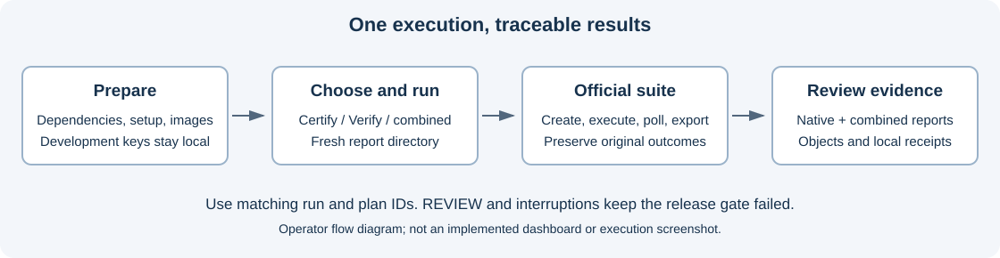

# Operator flows and interface design

The project is an automation harness. Its interfaces are the command line, the
official OpenID suite, existing TestNG/Extent reports and MinIO. It does not
implement a separate product dashboard. The flow and wireframe below describe
how an operator uses those existing interfaces.

## Setup and execution



1. Prepare Docker, Python, Chromium, Maven and the required Java versions.
2. Run `python runner/setup.py` before deployment or Python tests. Keep generated
   keys and configuration local. Prepare images as described in the README.
3. Select Certify, Verify or combined execution. Choose a fresh report directory.
4. Let the runner create and execute the official plans. Browser handoffs are
   automated; the operator does not manually create replacement plans.
5. Read the official results and gate decision. If startup fails, inspect logs;
   do not open reports from an older execution as if they belonged to this run.

## Review the same execution across interfaces

| Interface | Operator action | Association to preserve |
|---|---|---|
| Terminal | Read summary, exit code and reporter statuses | Fresh report directory and `run_id` |
| Official suite | Locate the generated issuer/verifier plans | Actual plan IDs from that summary |
| Native TestNG reports | Inspect module outcomes and extra gate assertion | `existing-certify/<run_id>/`, `existing-verify/<run_id>/` |
| Combined Extent report | Inspect both components and gate | `extent-report.html` from the same directory |
| MinIO console | Locate uploaded reports; compare with the local `artifact-storage-validation.json` receipt | `openid-conformance/<run_id>` artifact prefix |
| GitHub Actions | Inspect a named recorded revision | CI run ID and commit SHA, separate from a local run |

## Report navigation wireframe

This is a design reference for the demonstration flow, not a screenshot or a
newly implemented dashboard. Existing report pages provide the actual controls.

```text
Fresh execution: <run_id>                    Gate: FAILED
+------------------------+------------------------------------+
| Official issuer plan   | Native Certify report              |
| Official verifier plan | Native Verify report               |
| Storage prefix         | Combined Extent / TestNG report    |
+------------------------+------------------------------------+
| Select a module -> inspect original outcome -> inspect log  |
| Match plan / test / transaction IDs before viewing evidence |
+-------------------------------------------------------------+
```

A failed gate is an output of validation, not a button to override. REVIEW remains
REVIEW until the applicable official review supports another outcome. The harness
maps it to a failed assertion and preserves it in the original result data.
Patched issuer diagnostics are labelled separately and cannot qualify stock.

## Accessibility and demonstration

Use a readable terminal font and browser zoom. Show status names as text as well
as color, and state the difference between official module counts and TestNG's
extra gate assertion. Keep credentials, generated configuration and raw credential
contents off screen. Follow [the manual run commands](../README.md#run-both-components-and-inspect-reports).
